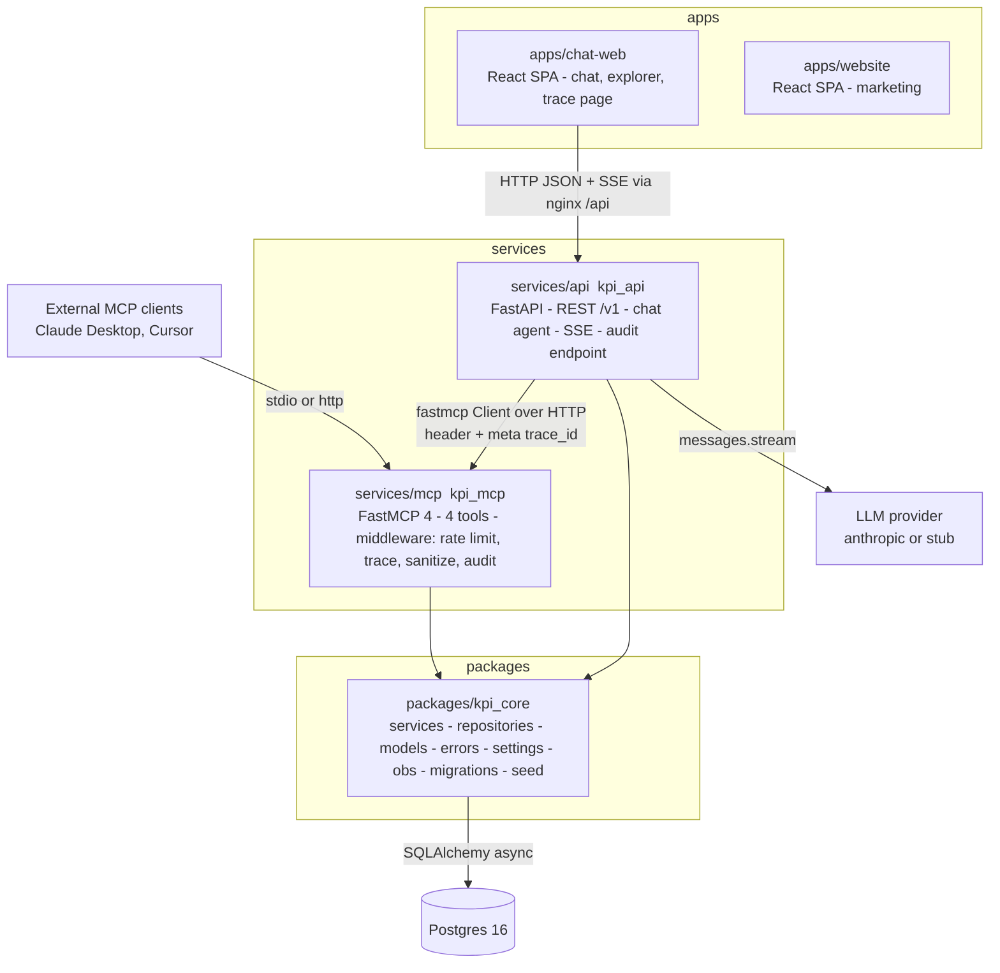

# Architecture

## Goals the architecture serves

1. Serve KPI estimates to humans (REST, UI) and to AI agents (MCP) from one source of truth.
2. Make every LLM answer explainable and auditable: which tools, which arguments, what came back.
3. Keep a hard boundary between the LLM and the data layer.
4. Stay small enough to read in an afternoon while being shaped like a production agent platform
   (modular, observable, multi-tenant-ready, testable, white-label).

## Components

### `packages/kpi_core` (the only place with business logic)

| Module | Responsibility |
|---|---|
| `models.py` | Pydantic DTOs shared by both adapters (`Company`, `KpiDefinition`, `KpiHistory`, `KpiQtd`, `Suggestion`, `ToolCallAudit`, `ChatMessage`, …) |
| `services/` | Use cases: `companies`, `kpis`, `estimates`, `audit`, `chat`. Async functions taking `RequestContext` + repository |
| `repositories/` | `protocols.py` (interfaces), `sqlalchemy_repo.py` (Postgres), `memory.py` (in-memory fake loaded from CSV, used by unit tests and the in-process MCP mode) |
| `errors.py` | `KpiError` hierarchy with `status`, `code`, `suggestions`, `recovery_hint`; `to_problem()` (REST) and `to_tool_envelope()` (MCP) |
| `fuzzy.py`, `validation.py`, `periods.py` | Suggestions (rapidfuzz + alias table), input normalisation, `YYYYQn` period arithmetic |
| `context.py` | `RequestContext(trace_id, tenant_id, principal, caller)` and a ContextVar |
| `obs/` | Correlation-id middleware (pure ASGI), JSON logging, request timing, optional OpenTelemetry |
| `db/`, `seed/`, `cli.py` | Engine/session, ORM rows, Alembic migrations, idempotent CSV seeder, `python -m kpi_core.cli migrate|seed` |

### `services/mcp` (protocol adapter for agents)

Four read-only tools; each is a thin function: validate → call one service → map the result to a
Pydantic model. Errors from the service are converted by `envelope.py` into `ToolError` carrying the
JSON envelope. Middleware chain: `RateLimitingMiddleware` → `TraceMiddleware` →
`ArgSanitizingMiddleware` → `AuditMiddleware`. Two transports: stdio (desktop clients) and
streamable HTTP (`/mcp`, used by the chat agent and remote clients).

### `services/api` (protocol adapter for humans + the agent host)

REST routers mirror the services one-to-one. The chat agent lives in `kpi_api.agent`: it fetches
tool schemas from the MCP server, converts them to Anthropic tool definitions, runs the tool loop,
streams events over SSE, persists the conversation and steps, and enforces the guards listed in
[security.md](security.md#llm-tool-calling-failure-modes-and-guards).

### Frontends

`apps/chat-web` (chat with tool execution panel, explorer with history-vs-QTD chart, trace page)
and `apps/website` (marketing). Both are static SPAs served by nginx; chat-web proxies `/api` to
the API with SSE buffering disabled.

## Request flows

### Chat question

1. Browser `POST /v1/chat {message, conversation_id?}` (SSE response).
2. `CorrelationIdMiddleware` adopts or mints `trace_id`; `RequestContext` is built server-side.
3. Agent emits `session`, loads the last N messages, fetches tool schemas from MCP (cached).
4. LLM turn → zero or more `tool_use` blocks. Each is sanitised, checked against the duplicate
   ledger, executed through the MCP client with a timeout, audited by the MCP middleware, and
   streamed as `tool_call_started` / `tool_call_finished`.
5. All `tool_result` blocks go back in one user message; loop until `end_turn` or a guard stops it.
6. `final` event; user + assistant messages and steps are persisted with the same `trace_id`.

### REST lookup

`GET /v1/companies/ORBY/kpis/total_revenue/history` → router → `services.estimates.get_kpi_history`
→ repository → Postgres → `KpiHistory` DTO → JSON. A `KpiNotFound` becomes a 404 problem+json
document with `suggestions`.

### External MCP client

Claude Desktop spawns `python -m kpi_mcp --transport stdio`; each `tools/call` runs through the same
middleware and service functions as the chat agent, so audit rows and logs look identical.

## Cross-cutting concerns

- **Identity and tenancy**: `RequestContext.tenant_id` defaults to `default`; the LLM never sets
  it. Path to RLS: [how-to/extend-to-multi-tenant.md](how-to/extend-to-multi-tenant.md).
- **Errors**: one hierarchy, two serialisations ([reference/error-codes.md](reference/error-codes.md)).
- **Observability**: `trace_id` on every log line, SSE session event, MCP call meta/header, audit
  row and chat message ([observability.md](observability.md)).
- **Security**: validation at both adapters, ORM only, rate limits, body caps, CORS allowlist,
  secrets via env, non-root images ([security.md](security.md)).
- **Configuration**: pydantic-settings with working defaults ([reference/configuration.md](reference/configuration.md)).

## Deployment shapes

Everything runs from `docker-compose.yml` locally, one compose profile per part (`backend`,
`chat`, `website`). Each service has its own image and can be deployed alone (API, MCP, static
SPAs, a migration job); see [how-to/deploy.md](how-to/deploy.md). The API can also run
the MCP server in-process (`KPI_MCP_MODE=inprocess`) for single-container deployments.

## What would change at scale

See [future-improvements.md](future-improvements.md): trigram index
for partial-name search, partitioning `kpi_estimates` by company, read replicas, Redis-backed rate
limiting, tool result caching, async ingestion, and per-tenant RLS.
