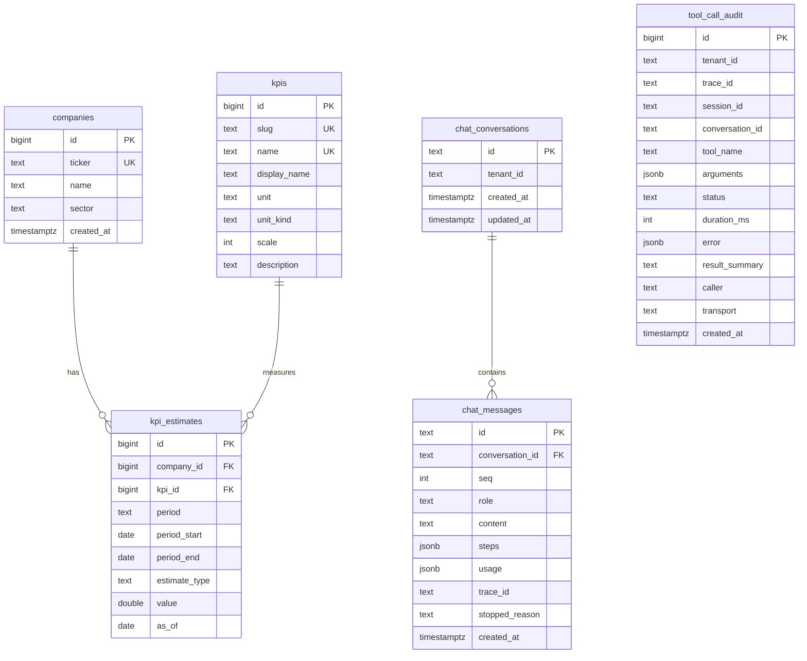

# Data model

## Source dataset

`data/kpi_sample.csv` (1 062 rows, fully synthetic, produced by
`scripts/generate_sample_data.py` with a fixed seed): 16 fictional companies across 14 sectors,
three to five of 13 KPIs per company, 14 historical quarters (2023Q1–2026Q2) and four QTD
snapshots for 2026Q3 (`as_of` 2026-07-31, 08-15, 08-31, 09-15). Columns: `company_name, ticker, sector, kpi,
period_start, period_end, period, estimate_type, value, unit, as_of`.

`data/demo_edge_cases.csv` (31 rows, loaded by `make seed-demo`) adds three companies designed to
exercise edge cases the sample cannot:

| Ticker | Company | Sector | What it demonstrates |
|---|---|---|---|
| `GAPW` | Gapwise Robotics | Industrial Tech | Only 2 KPIs, no QTD snapshots → "KPI not available for this company", "no QTD data" |
| `SPRW` | Sparrow Bio Software | Software | History with missing quarters + 2 QTD snapshots → chronological order with gaps, `note` |
| `FRSH` | Freshlist Labs | Marketplaces | QTD only, no history → empty history handled, QTD present |

## Entity–relationship

## Tables and constraints (migration `0001_initial_schema`)

- **companies**: `ticker` unique, `CHECK ticker ~ '^[A-Z0-9][A-Z0-9.\-]{0,9}$'`; indexes on
  `sector`, `lower(name)`, and a GIN trigram index on `lower(name)` (`pg_trgm`) for `%q%` search.
- **kpis**: `slug` and `name` unique. `slug` is the LLM-friendly id (`total_revenue`,
  `annual_recurring_revenue`, `net_revenue_retention`, `customer_churn`, …). `unit_kind` is
  `currency`, `count` or `percent`; `scale` is 1 000 000 for `$MM`, 1 000 000 000 for `$B`, else 1.
- **kpi_estimates**: `estimate_type in (historical, qtd)`; `as_of` is NULL iff historical;
  `UNIQUE NULLS NOT DISTINCT (company_id, kpi_id, period, estimate_type, as_of)` makes the seed
  idempotent; index `(company_id, kpi_id, estimate_type, period_start)` serves chronological
  history scans; partial index `(company_id, kpi_id, as_of DESC) WHERE estimate_type = 'qtd'`
  serves "latest QTD".
- **tool_call_audit**: one row per MCP tool call. `arguments` is the sanitised argument object;
  `result_summary` is a short human string (never the full payload); `error` is the envelope.
  Indexes: `trace_id`, `created_at DESC`, `(tool_name, status, created_at DESC)`.
- **chat_conversations / chat_messages**: `steps` holds the tool-call steps of an assistant turn
  (`id, tool, arguments, status, duration_ms, result_preview, error`); `trace_id` joins a message
  to its audit rows; `UNIQUE (conversation_id, seq)`.

## Normalisation rules (seed)

| CSV | Table/column | Rule |
|---|---|---|
| `ticker` | `companies.ticker` | trimmed, upper-cased |
| `kpi` | `kpis.name`, `kpis.slug`, `kpis.display_name` | name kept verbatim; slug = lowercase, unit suffix removed, non-alphanumerics → `_` (`Net Revenue Retention (%)` → `net_revenue_retention`) |
| `unit` | `kpis.unit`, `unit_kind`, `scale` | `$`→currency/1, `$MM`→currency/1e6, `$B`→currency/1e9, `%`→percent/1, anything else→count/1 |
| `estimate_type` | `kpi_estimates.estimate_type` | lowercased; `as_of` parsed to date or NULL |
| `value` | `double precision` | parsed float |

Seeding is an upsert in one transaction and reports `SeedReport(companies, kpis, estimates,
inserted, updated)`; a second run inserts 0 rows.

## Multi-tenancy path

`tenant_id` exists today on `tool_call_audit` and `chat_conversations`, and on every
`RequestContext`. Adding it to `companies`/`kpi_estimates` plus Postgres row-level security is
described step by step in [how-to/extend-to-multi-tenant.md](how-to/extend-to-multi-tenant.md).

## Why these choices

- Postgres over SQLite/DuckDB: JSONB for audit rows; RLS for the
  multi-tenant path; `NULLS NOT DISTINCT` (PG15+) for the idempotent natural key.
- Fuzzy suggestions in-process (rapidfuzz) rather than trigram similarity in SQL: the candidate
  lists are tiny (tens of rows), alias handling is domain logic, and the in-memory and SQL
  repositories must produce identical suggestions.
- No surrogate "estimate id" in the API: consumers address data by `ticker` + `kpi slug` +
  `period`, which is what an LLM naturally has.
