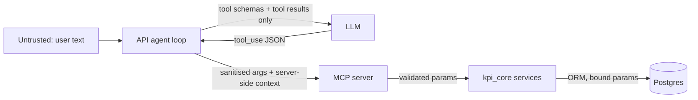

# Security

No login is required for the demo, so the focus is on the boundaries that matter for an
agent platform: **between the LLM and the data layer**, and **between callers and the services**.

## Trust boundaries

- The LLM sees tool schemas and tool results. It never sees SQL, table names, internal ids,
  tenant ids or principals.
- Tool arguments produced by the LLM are treated as untrusted input at two layers: the agent's
  `sanitize_tool_args` (drop unknown keys, cap lengths, strip control characters) and the MCP
  server's pydantic parameter models + `ArgSanitizingMiddleware`.
- `RequestContext.tenant_id` / `principal` are built server-side; tool schemas have no such fields.
- Data returned by tools is JSON from our own database, but the system prompt still instructs
  the model to treat text fields as data, not instructions.

## Input validation and sanitisation

| Surface | Mechanism |
|---|---|
| REST | pydantic query/path/body models; `ticker` regex, `period` regex, `limit` clamps, `q` ≤ 64 chars |
| MCP | pydantic tool parameter models with `max_length`/`pattern`; middleware rejects unknown keys, non-scalar values, control characters |
| Chat | message ≤ 4000 chars; body ≤ 16 KiB; conversation id must be a UUID |
| Correlation id | header validated; never used for authorisation |

## Never direct SQL

All queries are SQLAlchemy ORM `select()` with bound parameters. `scripts/audit_docs.py
--no-raw-sql` fails CI on `text(` or `execute("SELECT…")` outside migrations. The LLM cannot
express a query; it can only choose among four typed tools.

## Rate limiting and resource caps

- API: token bucket per client IP (`KPI_RATE_LIMIT_RPS`, `KPI_RATE_LIMIT_BURST`), `429`
  problem+json with `Retry-After`; `/healthz` exempt.
- MCP: FastMCP `RateLimitingMiddleware` (`KPI_MCP_RATE_LIMIT_RPS/BURST`).
- Agent: max iterations, max parallel tools, per-tool timeout, wall-clock budget, result
  truncation, history window.
- Limits are per process; a Redis bucket is listed in
  [future-improvements.md](future-improvements.md).

## LLM tool-calling failure modes and guards

| Failure mode | Guard | Test |
|---|---|---|
| Hallucinated ticker / misspelled KPI | Error envelope with `suggestions` + `recovery_hint`; prompt: retry once, then explain | `services/mcp/tests/test_error_envelope.py`, `agent/test_loop.py::test_recovery_after_company_not_found` |
| Unknown tool name | Agent rejects before calling MCP; `tool_result is_error` with the list of valid tools | `agent/test_loop.py::test_unknown_tool_is_rejected` |
| Malformed / truncated tool JSON | Parse errors become rejected steps; `max_tokens` with pending tool never executes | `::test_parse_error_is_rejected`, `::test_refusal_and_max_tokens` |
| Oversized or extra arguments | `sanitize_tool_args` + MCP sanitiser + pydantic caps | `agent/test_guards.py::test_sanitize_drops_unknown_and_non_scalars`, `mcp/tests/test_middleware.py::test_sanitizer_rejects_unknown_and_oversized` |
| Identity smuggling (`tenant_id` in args) | No such parameter exists; unknown keys dropped and counted | `agent/test_loop.py::test_identity_keys_dropped` |
| Infinite retry loop | Iteration budget (8) + duplicate-failing-call ledger + wall clock | `::test_max_iterations_stops`, `::test_repeated_failing_call_rejected` |
| Slow tool | `asyncio.wait_for` per call → `timeout` step, `is_error` result | `::test_tool_timeout` |
| Huge tool result | Truncation at `KPI_AGENT_MAX_RESULT_CHARS` with a note | `::test_result_truncation` |
| Model refusal / provider outage | `refusal` stop → explained final; provider errors → SSE `error` with partial steps persisted | `::test_refusal_and_max_tokens`, `::test_provider_outage_emits_error_and_persists` |
| Parallel tool results split across messages | All results of a turn returned in one user message | `agent/test_loop.py::test_happy_path_qtd` |

## Secrets and images

- Secrets only via environment (`ANTHROPIC_API_KEY`, database URL); `.env` is git-ignored;
  gitleaks runs in CI.
- Docker images are multi-stage, run as a non-root user, and expose only their port.
- CORS allowlist from `KPI_CORS_ORIGINS`; no wildcard in production settings (validator).
- Logs never contain secrets; user text is logged at DEBUG only.

## Not done (by decision)

Authentication/RBAC, per-tenant RLS, encryption at rest configuration, WAF. Each has a documented
path in [future-improvements.md](future-improvements.md) and
[how-to/extend-to-multi-tenant.md](how-to/extend-to-multi-tenant.md).
